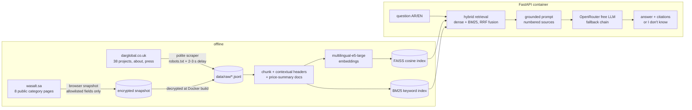

# DarGlobal & Wasalt RAG Chatbot

A bilingual (Arabic / English) chatbot that answers questions about **Dar Global** projects and **Wasalt** property
listings using only data scraped from their public pages — every answer cites the source page, and it says
**"I don't know"** when the data doesn't contain the answer.

**Live demo:** _LIVE_URL_ · **Example questions:** [EXAMPLES.md](EXAMPLES.md)

---

## Architecture



| Step | What happens | Code |
|---|---|---|
| Scrape | robots.txt check per URL, 2–3 s between requests, retries with back-off, identifying User-Agent | `scraper/http.py` |
| Clean | navigation/footer/cookie text removed; phone numbers and e-mails scrubbed | `scraper/clean.py` |
| Chunk | ~1,000-char chunks with 150 overlap; each chunk starts with `[Source / type / title / location]` so it stands alone | `rag/chunking.py` |
| Summaries | per city/type/purpose price summaries (min / median / max with links) so "cheapest villa in Jeddah" is answerable | `rag/summaries.py` |
| Embed | `intfloat/multilingual-e5-large` (ONNX via fastembed, CPU) — Arabic questions retrieve English pages | `rag/embeddings.py` |
| Index | FAISS `IndexFlatIP` on normalised vectors (exact cosine) + BM25 with Arabic normalisation | `rag/store.py` |
| Retrieve | top-30 from each, fused with Reciprocal Rank Fusion, top-6 to the model | `rag/store.py` |
| Generate | OpenRouter free model, temperature 0.1; strict rules: only the sources, cite `[n]`, `NOT_FOUND` otherwise; reply in the question's language | `rag/pipeline.py`, `rag/llm.py` |
| Serve | FastAPI `POST /api/chat`, chat UI with RTL support and clickable sources, per-IP rate limit | `app/` |

### "I don't know" and citations
The model must answer only from the numbered sources and return `NOT_FOUND` when they don't contain the answer;
the API turns that into *"I don't know…"* / *"لا أعرف…"* in the user's language and returns no sources.
Citations `[n]` are validated and renumbered against the sources actually shown, one entry per URL.
A specific guard handles a real trap in this data: Dar Global pages show *"Residency eligibility via property
investment SAR 4M+"* — the prompt forbids treating such figures as unit prices.

---

## How the scraping works

**Dar Global** (`scraper/darglobal.py`): reads the public catalogue at `/projects` (plus a seed list as fallback),
fetches every project page (38), the *About* page and recent press releases found in `sitemap.xml`.
Text comes from the server-rendered HTML; for client-rendered pages it falls back to the strings embedded in
Next.js `__NEXT_DATA__` (dropdown data such as country lists is skipped). robots.txt allows `/`, `/projects/`,
`/press/`; `sitemap_index.xml`, search and tracking URLs are disallowed and never requested.
Runs in GitHub Actions (`.github/workflows/scrape.yml`) and commits `data/raw/darglobal.jsonl`.

**Wasalt** (`scraper/wasalt.py`): category pages (e.g. `/en/villas-for-sale-in-jeddah`) embed their listings in
`__NEXT_DATA__`. Only an **allowlist** of listing facts is kept — type, city, district, price, size, rooms,
amenities, verification, dates. Owner/agent/contact fields, coordinates, street names, images and reference
numbers are never stored (`tests/test_scraper.py` checks this). `/search` is disallowed by robots.txt and never used.

Two things shaped the Wasalt part:
* **403 from cloud IPs.** wasalt.sa blocks automated requests from data-centre IPs (GitHub Actions) even though
  robots.txt and [llms.txt](https://wasalt.sa/llms.txt) allow extracting public listing content at a moderate rate.
  I did not try to bypass it (no fake browser headers, no proxies). Instead 8 public category pages were opened in
  a normal browser, one every ~10 s, and the same allowlist was applied inside the page
  (`docs/wasalt_browser_collector.js`) → `python -m scraper.wasalt_import import wasalt_snapshot.jsonl`.
* **No redistribution.** Wasalt's llms.txt forbids redistributing its data and asks for attribution. The snapshot is
  therefore committed **encrypted** (`data/private/wasalt.jsonl.enc`, Fernet); the Docker build decrypts it with the
  `DATA_KEY` build secret, builds the index and deletes the plain file. Answers link back to the live Wasalt page.
  Without the key the app still builds and answers from Dar Global data.

---

## Run locally with Docker

```bash
git clone https://github.com/waleedbar/darglobal-rag-chatbot && cd darglobal-rag-chatbot
docker build -t dgrag .                                  # downloads e5-large (~2 GB) and builds the index
docker run -p 7860:7860 -e OPENROUTER_API_KEY=sk-or-... dgrag
# open http://localhost:7860
```
* With the Wasalt snapshot: `docker build --secret id=DATA_KEY,env=DATA_KEY -t dgrag .` (key from the repo owner).
* No API key? `-e LLM_BACKEND=echo` runs a deterministic offline stand-in (retrieval still real).
* Tiny offline build for CI: `--build-arg EMBED_BACKEND=hash`.

Without Docker: `pip install -r requirements.txt && python -m rag.build_index && uvicorn app.main:app --port 7860`.
Tests: `pip install -r requirements-dev.txt && pytest -q` (offline: hashing embedder + fake LLMs).
Refresh data: `pip install -r requirements-scraper.txt && python -m scraper.run --only darglobal`.

### Configuration (environment variables — no secrets in the repo)
| Variable | Default | Purpose |
|---|---|---|
| `OPENROUTER_API_KEY` | – | OpenRouter key (platform secret) |
| `OPENROUTER_MODELS` | Llama 3.3 70B, Gemma 3 27B, Mistral Small 3.2, Qwen3 (`:free`) | fallback chain, tried in order on 429/outage |
| `EMBED_MODEL` | `intfloat/multilingual-e5-large` | embedding model |
| `TOP_K` / `RATE_LIMIT_PER_MIN` | 6 / 12 | chunks sent to the model / questions per IP per minute |
| `DATA_KEY` | – | build secret that decrypts the Wasalt snapshot |

## Deployment
Hugging Face Spaces (Docker, free CPU). `.github/workflows/ci.yml` runs the tests, builds the real image, smoke-tests
the container, prints a retrieval-quality report (`scripts/eval_retrieval.py`), then `scripts/deploy_hf.py` pushes
the repo to the Space and sets `OPENROUTER_API_KEY` / `DATA_KEY` as Space secrets from GitHub secrets.

## Limitations
* **Snapshot, not live data.** Scraped on 18 Nov 2026; prices and availability change — answers link to the live page.
* **Wasalt is a sample** (≈240 listings from 8 category pages), not the whole market; summaries say so. Wasalt
  *project* pages are client-rendered behind `/search` (disallowed), so Wasalt projects/developers are not covered.
* **Dar Global rarely publishes unit prices**; the bot says the price isn't in the data instead of guessing.
* **Free models** are rate-limited and sometimes slow; the app falls back across several free models and reports
  a temporary outage rather than inventing an answer.
* Aggregations beyond the pre-computed summaries (e.g. "average price per m² in Al Shati") are not exact — RAG
  retrieves text, it does not run SQL.
* Small corpus → exact FAISS search; for >100k chunks switch to HNSW/IVF and a re-ranker.

## Repo layout
```
scraper/   http.py (robots, rate limit) · clean.py · darglobal.py · wasalt.py · wasalt_import.py · seeds/
rag/       text.py · chunking.py · summaries.py · embeddings.py · store.py · llm.py · pipeline.py · build_index.py
app/       main.py (FastAPI) · static/index.html (chat UI)
data/      raw/darglobal.jsonl · private/wasalt.jsonl.enc
scripts/   eval_retrieval.py · deploy_hf.py
tests/     scraper + RAG + API tests (offline)
```

Data © Dar Global and Wasalt (Source: Wasalt.sa). Built for a technical assessment; not affiliated with either company.
