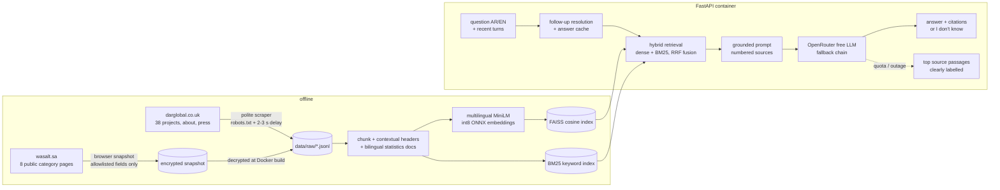

# DarGlobal & Wasalt RAG Chatbot

[](https://github.com/waleedbar/darglobal-rag-chatbot/actions/workflows/ci.yml)

A bilingual (Arabic / English) chatbot that answers questions about **Dar Global** projects and **Wasalt** property
listings using only data scraped from their public pages. Every answer cites its source pages, and the bot says
**"I don't know"** when the data doesn't contain the answer.

**Live demo:** **<https://darglobal-rag-chatbot.onrender.com>** · **Example questions:** [EXAMPLES.md](EXAMPLES.md) ·
**API:** `POST /api/chat` · `GET /api/health` · `GET /api/metrics`

## Highlights
* **Measured, not guessed.** A labelled set of 46 EN/AR questions ([eval/questions.jsonl](eval/questions.jsonl)) drives
  a retrieval evaluation with an ablation in CI (hybrid vs dense vs BM25, two chunk sizes) and an end-to-end grader
  for live answers. Retrieval: **hit@5 = 1.00, MRR = 0.92** (Arabic and English alike). Live answers: the first run
  found 3 failures, which were diagnosed and fixed (see [Evaluation](#evaluation)).
* **Arabic ↔ English.** Ask in Arabic about English pages (multilingual embeddings + Arabic-aware BM25 and place-name
  expansion, e.g. «عمان» → Oman/Muscat); the answer comes back in the question's language.
* **Grounded or silent.** Strict prompt + validated, renumbered citations; "I don't know" for unanswerable,
  off-topic and prompt-injection questions; "price not published" instead of invented prices.
* **Exact numbers for "cheapest / average / how much".** RAG can't compute statistics at query time, so they are
  computed at index time into small bilingual documents that retrieval finds reliably.
* **Follow-up questions** ("and when is its handover?", «وكم سعرها؟») without an extra LLM call.
* **Free-tier engineering.** Runs in **~180 MB** RAM on a 512 MB instance (from ~690 MB: int8 embeddings, mmap'd
  weights, SentencePiece tokenizer); free-model fallback chain discovered live; answer cache; if the model quota
  runs out the user still gets the relevant source passages instead of an error.
* **Responsible scraping.** robots.txt + llms.txt respected, rate-limited, PII never collected; Wasalt's
  no-redistribution term honoured by committing its data only encrypted.

---

## Architecture



| Step | What happens | Code |
|---|---|---|
| Scrape | robots.txt check per URL, 2–3 s between requests, retries with back-off, identifying User-Agent | `scraper/http.py` |
| Clean | navigation/footer/cookie text removed; phone numbers and e-mails scrubbed | `scraper/clean.py` |
| Chunk | ~500-char chunks (≈ the embedder's 128-token window) with 80 overlap; each starts with `[Source / type / title / location]` so it stands alone | `rag/chunking.py` |
| Statistics | per city × type × purpose: cheapest 5, most expensive 5, average/median/range, price by bedrooms - each a small document opening with the EN + AR words people use («أرخص», «متوسط»…), with links to the listings | `rag/summaries.py` |
| Embed | `paraphrase-multilingual-MiniLM-L12-v2` (ONNX, CPU, runs locally — no API quota spent) — Arabic questions retrieve English pages. Vocabulary table quantized to int8 at build time (cosine vs float32 ≥ 0.9999) | `rag/embeddings.py`, `scripts/quantize_model.py` |
| Index | FAISS `IndexFlatIP` on normalised vectors (exact cosine) + BM25 with Arabic normalisation | `rag/store.py` |
| Retrieve | top-30 from each, Reciprocal Rank Fusion, ≤3 chunks per page, top-8 to the model; follow-ups are resolved by prefixing the previous question (no extra LLM call) | `rag/store.py`, `rag/pipeline.py` |
| Generate | OpenRouter free model, temperature 0.1; strict rules: only the sources, cite `[n]`, `NOT_FOUND` otherwise; reply in the question's language | `rag/pipeline.py`, `rag/llm.py` |
| Serve | FastAPI `POST /api/chat` (question + recent turns), chat UI with RTL, citations and clickable sources, per-IP rate limit, answer cache, `/api/metrics` | `app/` |

### "I don't know" and citations
The model must answer only from the numbered sources and return `NOT_FOUND` when they don't contain the answer;
the API turns that into *"I don't know…"* / *"لا أعرف…"* in the user's language and returns no sources.
Citations `[n]` are validated and renumbered against the sources actually shown, one entry per URL.
Guards for real traps in this data: Dar Global pages show *"Residency eligibility via property investment SAR 4M+"*
(not a unit price); Wasalt rents don't state their period (the bot never calls them monthly/yearly); Wasalt
statistics are never presented as a Dar Global price. If a project is found but the detail (e.g. its price) isn't
published, the bot says so and links the page instead of a bare "I don't know".

---

## Evaluation
**Retrieval** (`scripts/eval_retrieval.py`, runs in CI on every push; full table in
[eval/retrieval_results.md](eval/retrieval_results.md)). 41 answerable questions (28 EN / 13 AR) labelled with
the page(s) that hold the answer; statistics questions must retrieve the exact statistics document.

| Configuration | hit@1 | hit@5 | MRR@10 | hit@5 EN | hit@5 AR |
|---|---|---|---|---|---|
| **Hybrid (dense + BM25, RRF), 500-char chunks - production** | **0.85** | **1.00** | **0.92** | 1.00 | 1.00 |
| Dense only | 0.78 | 1.00 | 0.88 | 1.00 | 1.00 |
| BM25 only | 0.73 | 0.95 | 0.82 | 1.00 | 0.85 |
| Hybrid, 1,000-char chunks | 0.80 | 0.95 | 0.88 | 0.96 | 0.92 |

What the ablation showed: hybrid fusion beats either retriever alone (BM25 alone is weak in Arabic, dense alone
ranks exact names lower); 500-char chunks beat 1,000 because the MiniLM embedder only reads ~128 tokens, so half of a
1,000-char chunk was invisible to it. I also tried routing "cheapest/average" questions to the statistics documents;
it gave no measurable gain once those documents were small and focused, so it was removed.

**Answers** (`scripts/eval_answers.py` via the manual `eval-answers` workflow against the live site, real free
model; details in [eval/answer_results.md](eval/answer_results.md)). Graded automatically: right page cited, all
`[n]` valid, expected fact present, correct language, "I don't know" for unanswerable / off-topic / injection.
* Run 1: **13/16**. Failures: "cheapest villa in Jeddah" answered from the 8 listings retrieved (1.3M) instead of the
  true minimum (950k), in EN and AR; "price of a Trump Tower Jeddah unit" got a bare "I don't know".
* Fixes: statistics split into small focused documents; prompt rule for "found, but detail not published".
* Run 2 (failures + new cases): **7/7**.

---

## How the scraping works

**Dar Global** (`scraper/darglobal.py`): reads the public catalogue at `/projects` (plus a seed list as fallback),
fetches every project page (38), the *About* page and recent press releases found in `sitemap.xml`.
Text comes from the server-rendered HTML; for client-rendered pages it falls back to the strings embedded in
Next.js `__NEXT_DATA__` (dropdown data such as country lists is skipped). robots.txt allows `/`, `/projects/`,
`/press/`; `sitemap_index.xml`, search and tracking URLs are disallowed and never requested.
Runs in GitHub Actions (`.github/workflows/scrape.yml`) and commits `data/raw/darglobal.jsonl`.

**Wasalt** (`scraper/wasalt.py`): category pages (e.g. `/en/villas-for-sale-in-jeddah`) embed their listings in
`__NEXT_DATA__`. Only an **allowlist** of listing facts is kept — type, city, district, price, size, rooms,
amenities, verification, dates. Owner/agent/contact fields, coordinates, street names, images and reference
numbers are never stored (`tests/test_scraper.py` checks this). `/search` is disallowed by robots.txt and never used.

Two things shaped the Wasalt part:
* **403 from cloud IPs.** wasalt.sa blocks automated requests from data-centre IPs (GitHub Actions) even though
  robots.txt and [llms.txt](https://wasalt.sa/llms.txt) allow extracting public listing content at a moderate rate.
  I did not try to bypass it (no fake browser headers, no proxies). Instead 8 public category pages were opened in
  a normal browser, one every ~10 s, and the same allowlist was applied inside the page
  (`docs/wasalt_browser_collector.js`) → `python -m scraper.wasalt_import import wasalt_snapshot.jsonl`.
* **No redistribution.** Wasalt's llms.txt forbids redistributing its data and asks for attribution. The snapshot is
  therefore committed **encrypted** (`data/private/wasalt.jsonl.enc`, Fernet); the Docker build decrypts it with the
  `DATA_KEY` build secret, builds the index and deletes the plain file. Answers link back to the live Wasalt page.
  Without the key the app still builds and answers from Dar Global data.

---

## Run locally with Docker

```bash
git clone https://github.com/waleedbar/darglobal-rag-chatbot && cd darglobal-rag-chatbot
docker build -t dgrag .                                  # downloads the embedding model and builds the index
docker run -p 7860:7860 -e OPENROUTER_API_KEY=sk-or-... dgrag
# open http://localhost:7860
```
* With the Wasalt snapshot: `docker build --secret id=DATA_KEY,env=DATA_KEY -t dgrag .` (key from the repo owner).
* No API key? `-e LLM_BACKEND=echo` runs a deterministic offline stand-in (retrieval still real).
* Tiny offline build for CI: `--build-arg EMBED_BACKEND=hash`.

Without Docker: `pip install -r requirements.txt && python -m rag.build_index && uvicorn app.main:app --port 7860`.
Tests: `pip install -r requirements-dev.txt && pytest -q` (offline: hashing embedder + fake LLMs).
Evaluate: `python scripts/eval_retrieval.py --chunks 500,1000` (index) · `python scripts/eval_answers.py --url http://localhost:7860` (live answers).

```bash
curl -s localhost:7860/api/chat -H 'content-type: application/json' -d '{"question": "and when is its handover?",
  "history": [{"role": "user", "content": "Tell me about Neptune"}, {"role": "assistant", "content": "..."}]}'
# -> {"answer": "... December 2027 [1].", "sources": [{"n": 1, "title": "Neptune, Interiors by Mouawad",
#     "url": "https://darglobal.co.uk/neptune", ...}], "lang": "en", "idk": false, "model": "...:free", "latency_ms": ...}
```
Refresh data: `pip install -r requirements-scraper.txt && python -m scraper.run --only darglobal`.

### Configuration (environment variables — no secrets in the repo)
| Variable | Default | Purpose |
|---|---|---|
| `OPENROUTER_API_KEY` | – | OpenRouter key (platform secret) |
| `OPENROUTER_MODELS` | Gemma 4 31B, Nemotron 3 Ultra, Gemma 4 26B, ERNIE 5.5 Flash (`:free`) | fallback chain, tried in order on 429/outage; intersected at startup with OpenRouter's live list of free models |
| `EMBED_MODEL` | `sentence-transformers/paraphrase-multilingual-MiniLM-L12-v2` | embedding model (build arg; `intfloat/multilingual-e5-large` is a larger alternative that needs ~2 GB RAM) |
| `TOP_K` / `RATE_LIMIT_PER_MIN` | 8 / 12 | chunks sent to the model / questions per IP per minute |
| `CHUNK_CHARS` / `CHUNK_OVERLAP` | 500 / 80 | chunk size (index build) |
| `CACHE_SIZE` / `CACHE_TTL_S` | 500 / 86400 | in-memory answer cache |
| `DATA_KEY` | – | build secret that decrypts the Wasalt snapshot |

## Deployment
**Render** free web service, Docker runtime, defined in [`render.yaml`](render.yaml) (auto-deploys on push to `main`).
`OPENROUTER_API_KEY` is a Render environment secret; `DATA_KEY` is a Render *secret file*, mounted only during the
image build to decrypt the Wasalt snapshot. (Hugging Face Docker Spaces now require a paid plan, so they were not used.)

**Fitting 512 MB of RAM.** The free instance has 512 MB. Measured per startup stage in CI (`scripts/mem_profile.py`):
| Change | Resident memory |
|---|---|
| fastembed defaults (fp16 ONNX up-cast to fp32 by onnxruntime) | ~690 MB → OOM |
| int8 vocabulary table + external, memory-mapped weights + no ORT arena | ~480 MB |
| XLM-R SentencePiece model instead of the 250k-entry `tokenizer.json` (ids verified identical at build) | **~180 MB** |

**Reliability on free tiers.**
* *Model quota*: OpenRouter's free models allow 20 requests/min and 50/day. The app discovers the currently free
  models at startup and falls back across them; repeated questions are served from a cache; a daily-quota error
  stops the fallback loop at once (it is account-wide) and the user gets the most relevant source passages,
  labelled as such - never an empty error.
* *Cold starts*: free Render instances sleep after 15 idle minutes (~50 s to wake). Until `KEEP_WARM_UNTIL`
  (the review period) the app pings its own `/api/health` every 10 minutes (no LLM call, no quota), and
  `.github/workflows/keep-warm.yml` pings it from outside as a backup (GitHub's scheduler is best-effort).

**CI** (`.github/workflows/ci.yml`): unit tests (21, offline) → production image build → run under `--memory=512m`
with a per-stage memory profile → API smoke tests in English, Arabic and a follow-up → retrieval evaluation + ablation
(published to the job summary).

## Limitations
* **Snapshot, not live data.** Scraped on 18 Nov 2026; prices and availability change — answers link to the live page.
* **Wasalt is a sample** (≈240 listings from 8 category pages), not the whole market; summaries say so. Wasalt
  *project* pages are client-rendered behind `/search` (disallowed), so Wasalt projects/developers are not covered.
* **Wasalt rents don't state the period** (monthly/yearly) in the listing data, so the bot reports them "as listed".
* **Dar Global rarely publishes unit prices**; the bot says the price isn't in the data instead of guessing.
* **Free models** are slow at times (3-25 s) and capped at 50 requests/day; on the cap the bot shows source
  passages instead of a written answer. Free hosting may still cold-start (~50 s) outside the keep-warm hours.
* **Statistics cover the pre-computed views** (by city / type / purpose / bedrooms). Other aggregations (e.g. price
  per m² by district) are not exact - a production version would add a structured query tool over the listings
  (text-to-SQL or function calling) next to RAG. Wasalt's built-up-area field looked unreliable, so no price/m².
* **Follow-ups** are resolved heuristically (short or pronoun-led questions reuse the previous question); an LLM
  query-rewriter would be more robust but costs a second request on a 50-per-day budget.
* **Evaluation size**: 46 hand-labelled questions is enough to compare designs, not to claim production accuracy.
* Small corpus → exact FAISS search; for >100k chunks switch to HNSW/IVF and a re-ranker.

## Repo layout
```
scraper/   http.py (robots, rate limit) · clean.py · darglobal.py · wasalt.py · wasalt_import.py · seeds/
rag/       text.py · chunking.py · summaries.py · embeddings.py · store.py · llm.py · pipeline.py · build_index.py
app/       main.py (FastAPI) · static/index.html (chat UI)
data/      raw/darglobal.jsonl · private/wasalt.jsonl.enc
eval/      questions.jsonl (labelled EN/AR set) · retrieval_results.md · answer_results.md
scripts/   eval_retrieval.py · eval_answers.py · quantize_model.py · prepare_tokenizer.py · mem_profile.py
tests/     scraper + RAG + API tests (offline)
.github/   ci.yml · scrape.yml (data refresh) · eval-answers.yml (live grading) · keep-warm.yml
```

Data © Dar Global and Wasalt (Source: Wasalt.sa). Built for a technical assessment; not affiliated with either company.
